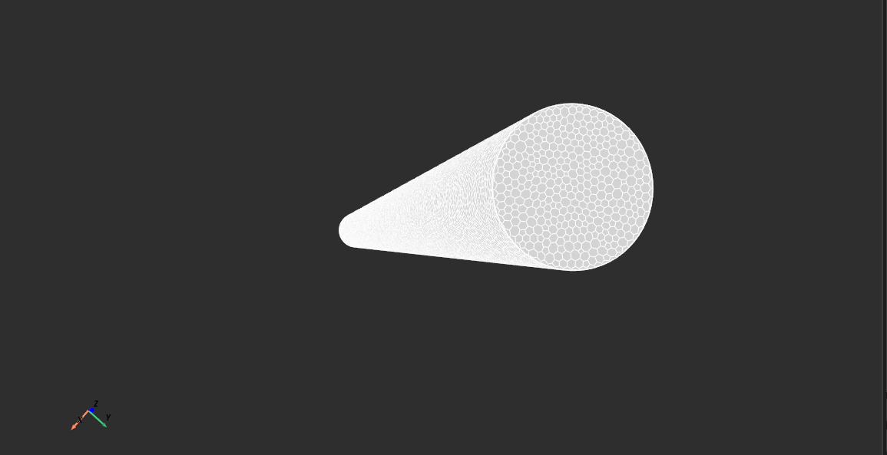
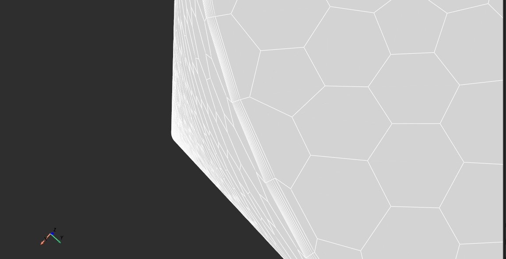

# PolyFoamMesh

Polyhedral meshes for OpenFOAM from a STEP or STL file, with boundary layers,
without hand-writing dictionaries.

GMSH, fTetWild and cfMesh produce the raw mesh. On top of that PolyFoamMesh adds
a tet→poly converter built for this project (barycentric dual) and a
boundary-layer engine that runs directly on the polyhedral mesh, patch by patch.
Everything is driven from a desktop GUI, and the result is exported as an
OpenFOAM case ready for the solver.

[GPLv3](LICENSE) · [Third-party licenses](THIRD_PARTY_LICENSES.md) ·
[Contributing](CONTRIBUTING.md) · [Changelog](CHANGELOG.md) ·
[Documentation](https://lorenzoriti.github.io/PolyFoamMesh/)

> **Development note.** The architecture and physics decisions are the author's;
> AI assistance was used to write code under that direction, and the author is
> responsible for it. Details in [AI_COLLABORATION.md](AI_COLLABORATION.md).

## What you get

<p align="center">
  
  
</p>

*A 398K-cell polyhedral mesh with 9 boundary layers in the built-in 3D viewer;
`checkMesh` passes (skewness 2.86, non-orthogonality 79.1°).*

- **Two meshing paths.** **Polymesh** (automatic, default) picks the tet engine from the
  measured geometry — GMSH first, fTetWild as fallback, every substitution logged —
  then builds the polyhedral dual and the boundary layer. **cfMesh** is the explicit
  Cartesian (hex) path.
- **Boundary layer on the polyhedral mesh**, on the patches you choose, with a
  y+-driven first-layer calculator and a report of requested versus achieved layers.
- **Patch roles** (inlet / outlet / symmetry / wall) that drive both the layers and the
  boundary conditions written to the case.
- **Virtual wind tunnel**: turn a loaded CAD object into an external-flow domain with
  refinement boxes on the object and in the wake.
- **Quality loop**: `checkMesh` → auto-fix → re-mesh (up to 3 iterations), and a PDF
  quality report.
- **Export** to an OpenFOAM case folder, BaramFlow case, CGNS or VTU.
- **3D viewer** with section cut and measure tools, undo/redo on parameters, case
  templates (internal flow, external aero, CHT), a plugin system, and a headless CLI
  and optional REST API.

## Where it fits

If you prepare OpenFOAM meshes by writing `blockMeshDict`, `snappyHexMeshDict` or
`meshDict` by hand and find problems only after `checkMesh`, this app does most of that
work: load the geometry, mesh with one click, watch the quality, export a case.

It targets OpenFOAM only and is not a replacement for a mature commercial mesher on
very complex geometry. Where the pipeline works well and where it does not — for
example sharp concave throats, where the polyhedral dual does not close perfectly — is
written down in [docs/KNOWN_LIMITATIONS.md](docs/KNOWN_LIMITATIONS.md), including
measured numbers.

## Install

Requirements: Windows 10/11 or Linux; Python 3.11+ (source install only); optionally
OpenFOAM v2512 (in WSL2 on Windows, native on Linux). GMSH-based meshing runs on
Windows without WSL; cfMesh and `checkMesh` need OpenFOAM.

```bash
git clone https://github.com/LorenzoRiti/PolyFoamMesh.git
cd PolyFoamMesh
pip install -e ".[test]"
pip install gmsh meshio reportlab
polyfoammesh
```

On Windows you can also double-click `launch_from_source.cmd` to start the latest
source in the folder. Full instructions: [docs/INSTALL.md](docs/INSTALL.md) (Windows)
and [docs/INSTALL_LINUX.md](docs/INSTALL_LINUX.md) (native Linux, no WSL).

## Documentation

- [Installation](docs/INSTALL.md) · [Linux installation](docs/INSTALL_LINUX.md)
- [User guide](docs/USER_GUIDE.md) — the workflow, tab by tab, with shortcuts
- [Known limitations](docs/KNOWN_LIMITATIONS.md) — what does not work yet, and why
- [Roadmap](docs/ROADMAP.md) · [Release notes 2.5.0](docs/RELEASE_NOTES_2.5.0.md)
- [Documentation index](docs/README.md)
- [Open issues](https://github.com/LorenzoRiti/PolyFoamMesh/issues)

## How it works

```
STEP / STL ──► tet mesh ──► polyhedral dual ──► boundary layer ──► checkMesh ──► OpenFOAM case
              GMSH or         barycentric        prisms on the      auto-fix
              fTetWild        (tet→poly)         chosen patches     loop
```

The GUI (PySide6) sits on an engine layer with no GUI imports (`src/polyfoammesh/core`),
which calls GMSH natively and OpenFOAM through WSL2 (or natively on Linux).

## Project structure

```
src/polyfoammesh/     Python package
  core/               engine layer: geometry, GMSH/fTetWild wrappers, dual, boundary layer, runner
  commercial/         advanced meshing modules (engine escalation, quality loops, AMR, ...)
  gui/                PySide6 interface: tabs, viewer, wizard, reports
  api/                optional FastAPI headless server
plugins/              plugin system
templates/            case presets (JSON)
locale/               translations
installer/            Inno Setup script and WSL/OpenFOAM setup helper
tests/                pytest suite (about 1,900 fast tests)
benchmarks/, tools/   benchmark harness and maintained developer tools
docs/                 user documentation; docs/dev holds maintainer notes
```

## Testing

```bash
pytest tests/ -m "not slow and not wsl" -q   # fast suite (what CI and the pre-commit hook run)
pytest tests/ -v                             # everything, including slow and WSL tests
python tools/release_gate.py --e2e           # release gate: versions, packaging checks, E2E
```

A `.pre-commit-config.yaml` runs `ruff` and the fast tests on every commit; install it
once with `python -m pre_commit install`.

## For maintainers

Building the packaged app and the installer: [docs/dev/DISTRIBUTION.md](docs/dev/DISTRIBUTION.md).

## Contributors

- [warriorman8](https://github.com/warriorman8) — reported the Arch Linux installation
  problem ([#11](https://github.com/LorenzoRiti/PolyFoamMesh/issues/11)).
- [otaolafranc](https://github.com/otaolafranc) — proposed evaluating alternative tet
  meshers, starting with fTetWild ([#12](https://github.com/LorenzoRiti/PolyFoamMesh/issues/12)).

## Trademarks

PolyFoamMesh is an independent project and is not affiliated with, approved by or
endorsed by OpenCFD Ltd, owner of the OPENFOAM® trademark. OPENFOAM® is a registered
trademark of OpenCFD Ltd. GMSH, cfMesh and other third-party tools named here are the
property of their respective owners; naming them describes interoperability only.

## License

GPLv3 — see [LICENSE](LICENSE) and [THIRD_PARTY_LICENSES.md](THIRD_PARTY_LICENSES.md).
